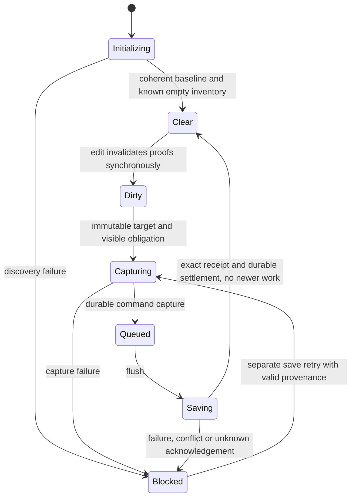

# I-AP-01 — strict Update admission vs Timeline outbox

Packet revision: 2, 2026-10-31 UTC. **Review-ready proposal; approval pending.**

Task lane: `lane/M-APP/I-AP-01`. Product base: App `7302b2992976ce7ed016738f7fe1086937f99384`. This packet contains design and proposed acceptance only. No implementation or test execution is claimed. Per D6 and M-INT's 21:40 instruction, the review route is Astra sense check followed by orchestrator approval; I-AP-02 must wait for that approval.

## 1. Decision and source boundaries

Apply D5 literally: **a local recovery snapshot is not a saved draft; a failed save permits no update POST.** Recovery preservation can protect work while an action fails. It cannot convert that failure into permission to Update, clear an outbox command, acknowledge an edit, or set the save badge to `saved`.

Proposed admission rule: an explicit Update may send one `POST /v1/update` only after every relevant draft owner is initialized, all current edits have a valid durable save acknowledgement, all captures have settled successfully, all outbox work has settled durably, and a synchronous check immediately before dispatch confirms those facts still hold. Delayed work may finish during the guard; unresolved work never passes. A failure aborts that click even if background retry succeeds later. Another POST requires a new explicit action.

| Input | Identity and verification boundary |
|---|---|
| App R1 | `7302b2992976ce7ed016738f7fe1086937f99384`; initial local `HEAD` and `refs/remotes/live/int/r1` both resolved here. Inspected with pinned `git show` and `rg`. During packet preparation the shared checkout moved to clean `lane/M-APP/I-AP-06` at `0d880bee58ee4e22ffe222aaac39e44bdc213fdf`; that commit has R1 as its parent. This task made no product Git/source changes and did not adopt that later HEAD as its base. |
| Timeline App delivery candidate | Supplied ref `tl/ux-integration`, abbreviation `735469a41590`. A read-only local object lookup resolves it to **`735469a41590040a81a64dc44614d37b2a1b6568`**. Local remote-tracking refs `live/lane/M-TL/delivery-20261028` and `origin/lane/M-TL/delivery-20261028` also resolve there. Commit tree: `47bc8a39f7c00f4f114d1ed239fd5cd7aba038c1`; parent: `d0d56507e28b93afaa91e8a7fd29f4269d2a506d`. Neither a local nor `live` remote `tl/ux-integration` ref was present. These are local Git observations, not an authenticated current delivery/ref-to-tree handover or current TLc acceptance. |
| Timeline source | No Timeline checkout inspected. All Timeline behavior below comes from the cited analysis, not a source audit of the candidate or current TLc. Before implementation/merge, M-TL/M-INT must attest the delivered full SHA, ref, tree and ancestry and reconcile this proposal against that exact source. |
| Runtime R1, context only | `8d208074669a31eed7efc4d964a602d6cd27e425`; supplied tuple context, not independently qualified by this task. |
| Agent R1, context only | `b05ac03a5bcab278bccf99d85b49f4037b5dec10`; supplied tuple context, not independently qualified by this task. |

Normative inputs, all read for this packet:

- [DECISIONS.md](/home/user/merge-docs/docs/merge-plan/DECISIONS.md), especially D5 and D6. D5 is settled policy. D6 gives the Sol design → Astra check → orchestrator approval route; M-INT's 21:40 instruction applies that route to this packet and says not to block on separate App owner/Track B assignments.
- [d3-app-persistence.md](/home/user/merge-docs/docs/merge-plan/evidence/explorers/d3-app-persistence.md), primary evidence for Timeline capture/outbox behavior and the recovery-builder collision.
- [w2-ci-app.md](/home/user/merge-docs/docs/merge-plan/evidence/explorers/w2-ci-app.md), App test lanes and environment limits.
- [e3-manager-readiness.md](/home/user/merge-docs/docs/merge-plan/evidence/explorers/e3-manager-readiness.md), exact identities, named owners, executable acceptance and handoff gaps.
- [w1-trackB.md](/home/user/merge-docs/docs/merge-plan/evidence/explorers/w1-trackB.md), historical/provisional guard evidence; not merged-tuple qualification or this design's signature.
- [MERGE-PLAN.md §3.3](/home/user/merge-docs/docs/merge-plan/MERGE-PLAN.md:159), [TASKS.md](/home/user/merge-docs/docs/merge-plan/TASKS.md), and [M-APP.md](/home/user/merge-docs/docs/merge-plan/managers/M-APP.md), defining I-AP-01/02/03/08 and protected acceptance.

Older recommendations in the explorer reports do not reopen D5. Historical `/home/user/work/...`, `/home/user/proof-codex` and `/home/user/repo` links in those documents are provenance, not verified current checkouts. This packet uses the supplied workspace and exact evidence paths.

The inspected TASKS.md also carries a later general revision-3 review policy limiting standalone Astra passes to other named designs. This task's explicit current review-authority update specifically requests the D6 Astra → M-INT route for I-AP-01; that specific user instruction governs this packet. No additional human or separate Track B signature is introduced.

## 2. What the pinned R1 source establishes

All source anchors in this section describe the R1 commit above, read with `git show <R1>:<path>`; local clickable links follow the shared checkout and are navigation aids rather than immutable commit links.

| Surface | Observed behavior | Design consequence |
|---|---|---|
| [useTimelineCommit.ts](/home/user/merge/ws/M-APP/repos/astrid-app/src/tools/video-editor/hooks/useTimelineCommit.ts:337) | Saving commits increment `editSeqRef` and synchronously emit `scheduleSave` at lines 398–400. Registry rollback also commits with `save: true`. | Invalidate at the mutation boundary and audit every alternate scheduling path; React render timing cannot own safety. |
| [useTimelinePersistence.ts](/home/user/merge/ws/M-APP/repos/astrid-app/src/tools/video-editor/hooks/useTimelinePersistence.ts:952) | `createScheduledSave` constructs the bundle, starts a serialized IndexedDB draft write, and assigns `latestScheduledSaveRef`. `scheduleSave` clears `reloadPreservedSeqRef` before recovery, reload, gesture, conflict and debounce branches. | Split pure construction, recovery writing, and capture. Preserve the early invalidation when Timeline adds another scheduling entry point. |
| [preservation and barriers](/home/user/merge/ws/M-APP/repos/astrid-app/src/tools/video-editor/hooks/useTimelinePersistence.ts:1147) | Barriers bind session identity, generation and sequence. Preservation calls the scheduled-save builder, restores the previous scheduling ref, awaits the draft write, reads the slot back, then marks the sequence preserved. | Restoring a ref cannot undo a capture side effect added by a merge. A pure recovery path is required. |
| [useTimelineSave.ts](/home/user/merge/ws/M-APP/repos/astrid-app/src/tools/video-editor/hooks/useTimelineSave.ts:54) | Owns initial recovery discovery, Retry/Discard and event wiring; returns save/flush/preservation methods. Recovery discovery is asynchronous; R1's discovery error is best effort. | Merged initialization and outbox discovery must report unknown/error explicitly; initial `saved` UI is insufficient. |
| [TimelineEditorShellCore.tsx](/home/user/merge/ws/M-APP/repos/astrid-app/src/tools/video-editor/components/TimelineEditorShellCore.tsx:438) | Mounted shell supplies save status, flush and recovery methods to browser defaults. | Keep actual mounted wiring; thread the authoritative owner read/flush methods through the chrome interface. |
| [useEditorBrowserDefaults.ts](/home/user/merge/ws/M-APP/repos/astrid-app/src/tools/video-editor/hooks/useEditorBrowserDefaults.ts:23) | A failed flush can be followed by successful recovery preservation; either `saved` or a preserved sequence admits the shared guard. Dirty check has the same fallback. | This fallback must never admit Update under D5. Save badge and recovery marker cease to be authorization inputs. |
| [draftSafeReload.ts](/home/user/merge/ws/M-APP/repos/astrid-app/src/shared/lib/updates/draftSafeReload.ts:24) | Flushes owners with `allSettled`, checks registration version and optional synchronous dirty checks for up to five waves. Hook registration is removed with the mounted surface. | Keep failure aggregation and version checks; require strict owner state for Update and retain unresolved Timeline owners independently of shell lifetime. |
| [UpdateResolutionActions.tsx](/home/user/merge/ws/M-APP/repos/astrid-app/src/shared/components/RuntimeConnection/UpdateResolutionActions.tsx:30) | Explicit action awaits `guarded.flush()` before `operation.start()`. Same component renders recovery-needed Update. | Retain this route and no bypass, while replacing the boolean-only authorization handoff. |
| [useInstallerUpdate.ts](/home/user/merge/ws/M-APP/repos/astrid-app/src/shared/lib/updates/useInstallerUpdate.ts:51) | `start()` awaits `confirmPermission()` after the draft guard. | A new edit or replacement in that await must invalidate admission. An action-level check alone leaves a gap. |
| [updateOperation.ts](/home/user/merge/ws/M-APP/repos/astrid-app/src/shared/lib/updates/updateOperation.ts:114) | Page-shared operation deduplicates dispatch, tracks lost acknowledgement, never automatically retries POST. | Preserve that behavior; serialize guard attempts across all callers and validate after permission awaits. |
| [client.ts](/home/user/merge/ws/M-APP/repos/astrid-app/src/integrations/runtime/client.ts:743) | `startInstallerUpdate()` reaches `installerUpdateRequest('POST', '/v1/update')`; R1 invokes fetch/transport before its first network await. | A synchronous final validator in the shared start path can cover the dispatch boundary; re-audit merged transport for intervening awaits. Keep POST body absent. |
| [AgentChat.tsx](/home/user/merge/ws/M-APP/repos/astrid-app/src/tools/video-editor/components/AgentChat/AgentChat.tsx:484), [projectChatDraftPersistence.ts](/home/user/merge/ws/M-APP/repos/astrid-app/src/tools/video-editor/components/AgentChat/projectChatDraftPersistence.ts:57) | Mounted chat guard plus a persistence-owned guard for dirty retained work. | Preserve both hydration and retained-owner protection when reconciling Timeline chat changes. |

R1's [timelineDraftIndexedDb.ts](/home/user/merge/ws/M-APP/repos/astrid-app/src/tools/video-editor/data/timelineDraftIndexedDb.ts:1) explicitly describes a coalesced recovery slot, without ordering or automatic replay. Do not treat it as Timeline's outbox. `saveTimelineDraft` can resolve without writing when IndexedDB is absent; a durability claim must check actual transaction/readback, not promise resolution alone.

The existing pre-Update implementation is already represented by `0a7bf4eb433cb838146109d783f848129bad212a`; caller-expectations commit `a3b55743c2b9d7720d1d0255db318637807cd766` is an ancestor of R1. Do not cherry-pick old M2-5 branches to obtain the guard. The explorer's Timeline observations are: per-edit `localDocumentSave.capture()` before debounce, a local session/outbox flush, a stable handoff during original-basis/identity loading, and a `scheduleSaveWithCapture` path. Their exact APIs and lifecycle remain to be verified at handover.

## 3. Ownership and state model

The following names specify responsibilities, not an implemented API. Reuse the verified Timeline session where possible; do not add a competing persistence engine.

- **Persistence owner:** one lifetime token for a provider/realm/project/timeline/local-document session. It owns edit revisions, captures, acknowledgements, outbox observation and recovery writes. It survives shell unmount while work remains. A new provider, identity binding or canonical replacement fences old receipts.
- **`useTimelinePersistence`:** creates immutable document values, explicitly schedules captures for edits, tracks each operation, maintains recovery proof, and exposes an authoritative synchronous state read plus strict flush.
- **`useTimelineSave`:** owns original-basis/identity initialization and recovery decisions; binds the stable Timeline save session to the persistence owner. It exposes readiness and failures even while no session is ready to capture. It passes owner state through existing shell/chrome wiring.
- **Browser defaults:** handles keyboard/unload behavior and registers the owner adapter. Its Update adapter uses strict owner state, not a displayed badge or local snapshot marker.
- **Shared draft coordinator and Update operation:** coordinate every Timeline/chat/retained owner, a single explicit action, permission validation and the final dispatch check.

An application-level inventory owner must discover durable pending outboxes for the selected installation/profile even if their document has not been mounted in this page. A missing editor is not proof of an empty outbox. Keep this owner initializing until the durable scan completes; register pending document/session owners or expose an aggregate blocking inventory. Scope changes retain unresolved old obligations rather than filtering them out. Reuse verified Timeline discovery/ownership facilities; if they cannot supply this evidence, Update remains blocked pending an App adapter decision.

For one owner, retain the following independently observable facts:

| Fact | Required meaning |
|---|---|
| `ownerToken`, `generation`, `scope` | Distinguish A → B → A lifetimes; scope includes provider/realm/project/timeline, local document/recovery identity, and relevant client binding. A string timeline ID alone is inadequate. |
| `editSeq`, `contentRevision` | Current logical edit and full persisted document identity. Every local content change invalidates prior proof synchronously; generation handles sequence reuse. |
| `acknowledgedTarget` | Exact owner/generation/edit/document covered by a successful Runtime receipt, or the coherent canonical baseline loaded with no local work. Not inferred from content equality after ambiguous failure. |
| `initialization` | Pending/ready/error for original basis, recoverable identity, recovery discovery, session binding and persisted outbox scan. No optimistic ready default. |
| `captureLedger` | Every requested capture's owner, target, promise and terminal result, including work waiting for initialization. A count reaching zero cannot erase rejection or an uncaptured edit. |
| `outboxState`, `outboxRevision` | Known loaded inventory plus queued/inflight/retrying/conflicted/rejected/acknowledgement-unknown work across relevant sessions. Unknown is blocking. A local enqueue receipt is not a Runtime save receipt. |
| `saveWork` | Scheduled/deferred edits, active flushes, retry timers, canonical reload and unresolved recovery decisions. Include gesture/reload/recovery deferrals and detached work. |
| `recoveryState`, `preservedTarget` | Pending/error or verified local recovery proof, scoped to owner/generation/edit/document/key/write owner. Independent from acknowledgement. |
| `stateRevision` | Synchronously changes whenever any admission-relevant fact changes. Final Update witnesses record it, not React's last committed state. |

Acknowledgement is owner-specific: Timeline requires its Runtime commit/save receipt and durable outbox settlement; chat requires its established durable draft-save contract. D5 prohibits substituting a recovery snapshot for either owner's failed normal save. It does not invent a Runtime timeline receipt requirement for a chat-only draft.

For strict Update, an owner is clear only if all of these hold:

1. Initialization and durable inventory discovery succeeded; scope and canonical baseline are known.
2. The current document is covered by the acknowledged target, with no uncaptured edit or unresolved recovery choice.
3. No pending, deferred or failed capture remains; no active/deferred save, conflicting write, retry or ambiguous outcome remains.
4. The loaded outbox is fully settled: no queued, inflight, retrying, conflicted, rejected or unknown intent, and no pending transaction that can add or restore one.
5. Required local durable writes/settlement for the save have completed successfully. An unresolved local storage error blocks; it cannot be hidden by a successful network response.
6. The owner is valid and still registered, or has completed an explicit, verified clean retirement. Unresolved retired owners remain registered.

`preservedTarget` is deliberately absent from this predicate. Clean initialization may acknowledge the loaded baseline without manufacturing a save command. Read-only examples/tours must be explicitly classified: no editable work and no relevant outbox permits a no-work owner; persistence disabled on an editable document is blocking.

Failed obligations can be resolved by a successful retry of the correct immutable target/command, or by an explicit verified recovery/discard operation under the existing protocol. Retain history for diagnosis, but do not make resolved historical failures permanent vetoes. A newer snapshot alone cannot cancel an older command whose remote outcome is uncertain. Resolving an obligation never revives an Update attempt already marked failed.

## 4. State transitions and invariants

Recovery is an orthogonal state (`absent`, `writing`, `verified`, `failed`). The Update-facing phases below derive from the facts above; implementations must not compress them into one save-status string.



Recovery-only writes change only the orthogonal recovery state and never create the `Saving → Clear` transition. Replacement starts a new initializing owner and retains the old owner if unresolved.

| Phase/event | Transition and admission result |
|---|---|
| Mount/rebind/restart hydration | Enter `initializing`; register before edits/Update can observe the surface as ready. Read original basis, identity and durable outbox inventory. Pending or failed reads block. |
| Initialized coherent baseline, no local/outbox work | Enter `clear`. Do not capture the baseline just to satisfy the guard. |
| Local mutation | Synchronously advance revision, clear `preservedTarget`, invalidate Update witness and record the edit/capture obligation **before** any await, debounce or early return. Enter `capture-pending`/`dirty`. |
| Capture waits for identity/original read | Obligation is already visible, bound to its owner and immutable target. Update remains blocked. No resolved placeholder promise may masquerade as capture completion. |
| Capture durably succeeds | Move the command to known queued outbox work. Capture completion alone never acknowledges the edit. |
| Capture/storage failure | Enter `blocked`; retain edit and recoverable data. Clear no acknowledgement or failure on a `finally` decrement. The active Update attempt fails. |
| Strict flush starts | Drain the captured target through the established Timeline session; enter `saving`. Never send a command before its capture is durably admitted. |
| Valid Runtime receipt + durable local settlement | Advance only the target actually acknowledged. If a newer edit/capture/command remains, stay blocked/dirty; otherwise enter `clear`. |
| Conflict, rejected command, transport failure or lost save acknowledgement | Enter `blocked`/`uncertain`; preserve work, surface cause, reject Update. Do not treat matching remote content as authorship proof. |
| Recovery-only preservation | Write/read back a snapshot; set only recovery proof if all fences still match. It neither enters `clear` nor changes capture/outbox inventory. |
| Replacement/unmount | Invalidate witnesses; retain unresolved owner and frozen inputs/session. Reject waiters bound to the replaced UI lifetime. Register replacement separately; no old receipt may acknowledge it. |
| User resolves recovery/conflict | Retry uses ordinary capture/flush with original provenance. Explicit discard requires proof of the exact target and no potentially executing uncertain command; then adopt a fresh baseline in a new generation. Update itself never discards. |
| Late successful retry after a failed Update click | May make the owner clear for a future explicit click; never resumes or creates the failed action's POST. |

Mandatory invariants:

- **D5:** any capture/save/required durable-settlement failure in an action aborts it; successful recovery preservation does not mask the original error.
- **Full coverage:** acknowledge exactly a captured document and its owner/generation. Signature equality, empty pending count, a resolved enqueue call, or an old `saved` render is not sufficient.
- **Early invalidation:** every edit path invalidates recovery proof and action witnesses before deferral; every admitted edit has a visible capture obligation.
- **No recovery recapture:** building or preserving a recovery snapshot invokes no capture, command enqueue, Runtime writer, flush, debounce or autosave scheduling.
- **Single ownership:** late completions update their original retained owner only. They cannot mutate a replacement's refs, clear its recovery slot, or borrow its sequence.
- **No disappearing work:** unregistering a shell or swapping providers cannot remove unresolved work from the global predicate.
- **Explicit execution:** one admitted click dispatches at most one update POST; polling, hydration, retries, reconnect and recovery discovery dispatch none.
- **Fail closed:** missing readiness, inventory, required owner check or receipt blocks Update. Errors/timeouts keep the page and drafts available.

## 5. Separate construction, preservation and capture

Replace the overloaded scheduled-save builder with three conceptual operations:

1. **Build document snapshot.** Pure construction from a single immutable target and explicitly supplied provenance. Clone config, registry, effective bundle/source items, transcript references and forward-compatible envelope metadata. Include base version/head, scope, sequence/generation and content identity. Preserve the existing distinction between complete recovery payload and provider wire `undefined`/`null` semantics. Do not read a polled head later or retain mutable editor data across awaits. Construction performs no persistence or scheduling and does not assign `latestScheduledSaveRef`.
2. **Write/verify recovery snapshot.** Serialize writes per recovery slot, await transaction completion, read back and compare complete payload plus owner/key/provenance. Set recovery proof only after rechecking owner, generation, current sequence/content and scope **after the final await**. A preservation operation may retry a changed target for a bounded number of waves; exhaustion rejects. It leaves normal pending network work untouched.
3. **Capture edit command.** Called explicitly by an edit save path with an immutable target. Register a pending obligation synchronously, then invoke/await the verified `localDocumentSave.capture()` contract. Track synchronous throws, asynchronous rejection and durable enqueue completion. Schedule remote flush only after capture succeeds. Retrying an unchanged target must reuse the session's command identity or verified deduplication; repeated Update clicks must not invent duplicate intents.

Normal edit ordering is: invalidate → snapshot target → record capture/recovery obligations → start independent durable operations → await required completion → flush eligible commands → validate Runtime receipt → durably settle outbox → publish acknowledgement. Network debounce/gesture suppression affects flush timing, not visibility of obligations. Recovery and outbox need not be in a newly invented cross-store transaction: if one succeeds and the other fails, retain both facts and block until reconciled. Do not roll back one by silently deleting the other.

Recovery-only callers, including preservation after flush failure and the R1 save-as-copy path currently using `createScheduledSave(...).draftWrite`, use only operations 1 and 2. They must not create command IDs, alter normal scheduling refs, or attempt a server write. Await recovery writes even on the error path, but report the original save failure as the reason Update was denied; attach recovery failure as additional detail.

Recovery slots retain compare-and-delete ownership fences. An old save receipt clears only its owned slot; a newer preservation write must not be erased by it. A preserved marker must also be invalidated on slot replacement/clear or changed recovery scope, not only on content edits. Recovery proof is evidence of the exact verified local record, not a perpetual claim about storage.

Verify the delivered session's shared-writer contract. If another tab/worker can mutate the same outbox or recovery slot, a stale in-memory empty inventory is insufficient: use the established exclusive owner/lease and revision protocol, reject foreign recovery ownership, and invalidate on external change. If stable ownership cannot be proven, fail closed. This packet establishes no cross-tab atomicity from a page-local counter; exact storage/session coordination is part of A5's source audit.

## 6. Invalidation and edit-path audit required in I-AP-02

Implement one synchronous invalidation/obligation boundary shared by both scheduling entry points; do not duplicate safety logic in debounce branches. If an edit is temporarily unable to capture, register that obligation before returning. Do not increment the logical edit sequence again when resuming an already recorded edit.

| Path to verify against delivered source | Required treatment |
|---|---|
| `applyEdit` / `commitData(save: true)` | R1 increments and emits synchronously. Invalidate before persisted content becomes observable; audit listeners/re-entrancy and registration gaps. |
| `scheduleSave` | Preserve R1's first-operation invalidation, including calls using `preserveStatus: true`. Display suppression never suppresses safety state. |
| Timeline `scheduleSaveWithCapture` | Use the same boundary even if this entry bypasses `scheduleSave`. Track the capture immediately and await its actual result. |
| Gesture drag/resize and interaction end | Every admitted content change invalidates; deferred payload/capture work blocks until the final target is acknowledged. Resuming does not recapture the same target. |
| Recovery/original-read/identity deferral | Maintain edit obligation and immutable provenance without overwriting an unresolved recovery record. Resolution resumes through normal capture once, not a placeholder success. |
| Canonical reload in progress | A local edit invalidates proof, supersedes unsafe adoption and remains visible as deferred work. Canonical replacement increments generation even if sequence resets. |
| Undo/redo, registry patch/unpatch/owned rollback | Each actual persisted content change follows the same invalidation/capture rules; returning to equal content does not revive an old marker. |
| Source plane/bundle/transcript, import, registration, automated editor changes | Cover the full persisted document, not config-only signatures or pointer gestures. Inventory every merged writer and justify any non-edit path. |
| Retry/watchdog/reconnect | Retrying unchanged work keeps its obligation/command identity; no manufactured new edit. Changed work invalidates normally. A retry cannot resurrect a failed action. |
| Provider/identity replacement, A → B → A, poll adoption, recovery discard, unmount | Fence prior generation and witnesses; clear recovery proof; retain unresolved work. Server-authoritative adoption is not silently applied over pending local work. |

I-AP-02's review receipt must list all actual merged edit/capture entry points and map each to this boundary. That audit is required because Timeline source was not inspected here.

## 7. Strict flush and final Update admission

### Owner barrier

The strict owner flush reads authoritative synchronous state, never returns early on `saveStatus === 'saved'`, and never calls a recovery-only helper as a success substitute.

For the current target: require initialized identity/basis/inventory; await all captures and required local writes through that target; flush the established session/outbox; await Runtime acknowledgement and durable local settlement; re-read target, ledger, pending work and inventory. A changed edit needs another wave. A permanent conflict, missing identity, storage error, rejection, replacement or ambiguity rejects. Pending work may wait to completion under the action deadline; it is never optimistically ignored.

Outbox checks cover the application-level durable inventory and every retained unresolved owner, not merely the latest mounted session. Discovery of older persisted commands creates replay obligations before the inventory owner can report clear, including documents never opened in this page. Failed capture with an empty outbox remains blocked because the edit has no acknowledgement. An acknowledged command with pending local settlement also remains blocked.

Keep R1's bounded five-wave coordinator behavior, with an overall finite deadline; proposed guard deadline is 30 seconds, subject to reviewer disposition. The deadline ends the action, not ownership of the save. Do not cancel/delete a command to make the deadline pass. A never-settling identity/capture promise ends with visible failure and zero POST; later completion cannot restart that action. Avoid multiplying five owner waves by five global waves without an overall bound.

### Action and dispatch protocol

The existing boolean `guarded.flush()` result alone cannot authorize a later POST. Proposed protocol:

1. An explicit Update click obtains a page-shared attempt gate for the selected update operation. Duplicate clicks from Settings/recovery cards while preparing or posting are ignored, not queued. Keep a distinct preparing phase; do not mark a network request as sent while only saving drafts. Snapshot each owner's failure revision and observe admission-relevant failure events for this attempt. An existing unresolved failure denies this click; any new capture/save/required-settlement failure latches the attempt as failed, even if a background retry makes the owner clear before another owner finishes. The attempt moves once from preparing to denied or dispatched; neither terminal state can resume. A separate save/recovery resolution and fresh explicit Update are required after denial.
2. Flush all registered strict owners, including Timeline and chat retained owners. Reject the action on any failure. Recheck registration version and owner state after each wave. A required owner without a synchronous checker is an error for Update; no optional-check success default.
3. When all owners are clear in a stable registry wave, create an action-scoped witness: registry version, each owner token/generation/state revision, selected Runtime base/instance/client binding, and this action's identity. It has no authority beyond this click.
4. Pass a mandatory synchronous validator with that witness through `useInstallerUpdate.start()` into the shared `UpdateOperation.start()` path. After permission confirmation and any other async preparation, recheck current availability, permission and selected Runtime identity. Reserve the existing single-dispatch slot.
5. **Immediately before** invoking the update client, validate the registry, every owner and the attempt's failure latch again. Run this after synchronous pending-state publication/subscriber callbacks too. If witness or clear state changed, abort locally with zero POST and a save/retry explanation; do not classify this as an unknown network acknowledgement. No await, timer, effect, subscriber callback or other re-entrant work may intervene between the final check and fetch/transport dispatch. Re-audit the delivered client/transport; move the validator closer to dispatch if necessary. Local validation failure must leave remote operation IDs, lost-ack state and pending status unchanged or restored to idle; the existing network-error catch/refresh path must not turn a never-sent request into uncertain remote work.
6. Consume the witness once and dispatch the existing bodyless POST. Retain current busy/status/auth/installation ownership checks and no-automatic-POST-retry semantics. Successful dispatch is not permission for an automatic reload: any later reload performs its own draft check.

Edits during the owner barrier may be saved by a subsequent wave. An edit, capture, new owner, unmount, identity change or outbox change after witness creation invalidates it; this action stops before POST. The existing page operation still deduplicates remote starts. A new global attempt gate also prevents two independent guard preparations from outliving each other and posting sequentially after one request has already completed.

The guarantee is evaluated at dispatch. A future edit cannot be predicted or retroactively cancel an accepted POST. New work after dispatch remains a tracked obligation and blocks later reload; it does not inherit the consumed witness. Other Runtime clients remain subject to Runtime's own update/save admission, outside this App guard's authority.

R1's `LocalPageUpdate` helper has no production caller in the pinned App source. If adoption/merge makes that fully-local launcher route reachable, it must consume the same strict attempt and revalidate after launcher URL/token preparation, immediately before the action-engine POST. This packet does not infer that a dormant helper is an active bypass or authorize a launcher/Runtime change.

### Unmount, replacement, errors and Reload

Move Timeline guard ownership from shell cleanup to a retained persistence/session owner. Register before editable work is exposed. Unmount invalidates the active attempt and transfers unresolved capture/flush inputs to that owner atomically, before the shell unregisters. If safe detached draining is unsupported, retain a blocking owner and require remount/rebind to resolve it; never substitute new provider refs. A clean owner may retire only after its durable inventory and active work are proven settled.

Keep chat's mounted hydration protection and `ProjectChatDraftPersistence` retained guard. A clear Timeline cannot waive a dirty chat draft or queued chat submission; pending/failed chat save also denies Update. Initial hydration gaps must not appear as a registry with no owners.

Separate action intent explicitly: strict **Update** and **Reload** cannot share a callback that admits a recovery fallback without knowing which action is requested. D5 does not itself settle every manual recovery-reload policy. Proposed conservative default for the merged shared entry point is the strict predicate for both intents until reviewers approve a separate reload-only proof. Existing R1 restart journeys that admit Reload from local recovery must be reviewed, not silently deleted or presented as passing under this change. If a separate recovery Reload is approved, it must prove complete durable recoverability including capture/outbox obligations, issue no update POST, and cannot produce an Update witness. Decision A7 below records this boundary.

User-visible denial keeps the editor and unsaved work open, identifies the failing draft owner, and offers save/recovery resolution followed by a fresh explicit Update. Recovery success may be described as local recovery protection; the save badge remains unsaved/error until actual save success. No “Update anyway” or automatic continuation after failure.

## 8. Race and failure obligations

| Race/failure | Required observable outcome |
|---|---|
| Recovery snapshot succeeds after Runtime save failure | Original action fails; zero POST even when the marker matches current sequence. |
| Capture resolves late or rejects after old UI says saved | Pending/error obligation blocks. Only full acknowledgement + settlement can clear. |
| New edit lands while another owner is flushing | Coordinator sees changed revision; drains another wave or fails within bound. No old-target admission. |
| Edit/owner change during `confirmPermission()` | Witness fails immediately before send. Zero POST. |
| Deferred gesture or `preserveStatus` edit | Dirty predicate sees obligation despite unchanged badge. |
| Empty outbox with capture failure; nonempty outbox with equal content | Both block. Neither absence nor content equality acknowledges a command. |
| Older acknowledgement races newer recovery write | Older receipt cannot delete newer slot or acknowledge newer target. |
| Sequence reused after canonical reload or A → B → A | Token/generation rejects prior witness and receipt. |
| Editor unmounts before capture/flush settles | Active action invalidates; retained owner blocks further actions until reconciled. No empty-registry escape. |
| IndexedDB absent, aborted, full, corrupt or wrong owner read back | Required durability is unproven; preserve failure and zero POST. Read success alone is not proof of transaction commit. |
| Crash between capture, remote commit and local settlement | Startup inventory stays initializing until scanned. Replay reuses original command identity, reconciles receipt, and blocks Update until durably settled. |
| Save acknowledgement lost | Remain uncertain; existing idempotent replay/receipt protocol must prove resolution. R1 content-equality fallback cannot manufacture proof. |
| Update acknowledgement lost | No second POST from polling, timeout, reconnect or saved-state changes. Preserve existing operation uncertainty handling. |
| Missing owner check, failed outbox scan, repeated edits or deadline | Fail closed with work retained; no waiver based on historical green test counts. |

## 9. Proposed I-AP-03 mounted acceptance mapping

All IDs below are proposed test names, not existing or executed tests. The authoritative acceptance harness must mount the actual Timeline save/persistence owner and shell/browser-default registration plus `UpdateResolutionActions`, with deterministic provider, IndexedDB and session seams. Mounting only a fake registered guard or mocking `flushPendingSave()` to succeed does not establish this integration guarantee. Keep existing helper tests as supporting coverage.

Proposed new file: `src/tools/video-editor/components/TimelineUpdateGuard.test.tsx`. Instrument the update transport and assert `POST /v1/update` counts at each blocked phase, not only `operation.start` spies. Record ordered events for target edit, capture start/durable completion, flush, Runtime receipt, durable outbox settlement, final validation and POST. Use controlled promises/transactions and clocks; do not use arbitrary sleeps as ordering proof. Run applicable rows for normal Update and `recovery-needed` Update.

| Proposed ID | Mounted setup/action | Required assertions | Supporting source tests to retain/adapt |
|---|---|---|---|
| AP03-01 | Edit → held capture → explicit Update | Zero POST while capture unresolved; flush never outruns durable capture. Release capture, then require receipt and settlement before one POST. | `useTimelinePersistence.test.tsx`, `useTimelineSave.test.tsx` |
| AP03-02 | Capture throws/rejects, then recovery snapshot succeeds | Zero POST; unsaved/error retained; original failure visible; a later successful retry cannot resume the old action. | Persistence/save tests |
| AP03-03 | Capture durable → held Runtime flush | Zero POST before receipt; after success and settlement exactly one POST. Held local settlement still blocks. | Persistence tests |
| AP03-04 | Flush fails/conflicts or acknowledgement is unknown; recovery verifies | Zero POST for both action variants, no `saved` badge from recovery, no “Update anyway”. | Browser defaults, action tests |
| AP03-05 | Update offered only after save already complete | Explicit click produces exactly one POST with no unnecessary recapture; no click produces none. | `InstallerUpdateCallers.test.tsx` |
| AP03-06 | Edit during Timeline flush or chat flush | Acknowledging old sequence does not post. Save new target or hit bounded failure; POST only after all latest targets settle. | Browser defaults + chat persistence tests |
| AP03-07 | Identity/original basis/recovery/outbox read pending, then fails | Zero POST during initialization and after failure; no false empty inventory or placeholder success. | Save recovery/identity tests at verified Timeline source |
| AP03-08 | Swap provider/session A → B → A with reused sequence | Late A receipt cannot acknowledge new A or mutate/delete its recovery; action has zero POST. | Persistence target/generation tests |
| AP03-09 | Unmount while capture pending; unmount before debounce; replace owner during another flush | Active click fails; next click still sees retained work; no empty-registry escape; remount can resolve exact work. | Persistence unmount tests + retained chat tests |
| AP03-10 | IndexedDB unavailable/abort/quota/readback mismatch; partial success of recovery vs outbox | Zero POST for unresolved required local durability; no marker set on missing/wrong record; complete data retained. | `timelineDraftIndexedDb.test.ts` |
| AP03-11 | Preserve target N, then mutate via each path in §6, including `scheduleSaveWithCapture`, gesture, `preserveStatus`, undo/redo and registry rollback | Marker invalidated synchronously; before any render/debounce Update cannot pass old proof. Include equal-content return and sequence reuse. | Commit/persistence tests |
| AP03-12 | Invoke recovery-only preservation and conflict save-as-copy | Capture/enqueue/Runtime writer invocation counts do not increase; pending command identity and scheduling refs unchanged; no POST authority granted. | Persistence recovery tests |
| AP03-13 | Outbox queued/inflight/retry/conflict/rejection/unknown and no visible new edit; include a durable command for a document never mounted in this page | Each unresolved state blocks through application-level inventory; empty outbox after failed capture still blocks; resolved promise with unresolved inventory blocks. Foreign shared-writer ownership or unknown inventory revision blocks. | Verified Timeline outbox/session tests |
| AP03-14 | Timeline clear, chat dirty/hydrating/failed; then chat unmount | Zero POST until chat acknowledgement, including retained owner; queued chat work is not dropped. | `AgentChat` tests, `projectChatDraftPersistence.test.ts` |
| AP03-15 | Begin Update, pause permission confirmation, then edit/add owner/change Runtime binding | Final synchronous validator rejects; zero POST. Include re-entrant mutation during pending-state publication. | `useInstallerUpdate` / `updateOperation` tests + callers |
| AP03-16 | Simultaneous Settings/recovery-card clicks and repeated clicks during guard | One global attempt; success yields one bodyless POST. Busy/permission/auth refusal yields none; no queued second start. | `InstallerUpdateCallers.test.tsx` |
| AP03-17 | Never-settling capture/read and continued edits | Deadline/wave bound yields visible denial and zero POST; settling later does not trigger a POST. | Coordinator/barrier tests |
| AP03-18 | Tear down and remount from actual durable pending outbox; also simulate remote-ack/local-settlement crash gap | Startup blocks through discovery/replay; same command identity, one logical commit, no duplicate recovery capture. Fresh click allowed only after reconciliation. | Verified Timeline restart/session tests |
| AP03-19 | Mount, poll status, reconnect, or surface `recovery-needed` without clicking | No POST. After a failed Update, polling/background save cannot retry Update. Lost Update acknowledgement never auto-retries. | Action/caller/operation tests |
| AP03-20 | After successful dispatch, create new work then request Reload | Consumed witness cannot authorize navigation; reload reevaluates owner state under approved A7 policy. | Browser defaults + build/reload tests |
| AP03-21 | While two owners drain, one capture/save fails and an automatic retry succeeds before the second owner finishes; also fail local final validation after pending-state publication | Failure latch denies the original click despite a clear final owner state; zero POST and no invented remote pending/unknown operation. A later explicit click after independent successful save can pass. | Coordinator/operation tests and mounted editor |

Adapt the existing `useEditorBrowserDefaults.test.tsx` test admitting local recovery after a failed acknowledgement: it must not establish Update permission. Preserve recovery durability verification tests and explicitly classify any reload-only expectation under A7. Preserve both Release-1 and Timeline test inventories when reconciling conflicts; protected guard/persistence cases cannot enter the known-failure ledger.

Proposed commands for I-AP-02/03 after source verification and implementation, **not run in this task**. Run from the implemented App checkout with its supported locked toolchain/dependencies:

```sh
npm run test:app -- src/tools/video-editor/components/TimelineUpdateGuard.test.tsx
npm run test:app -- src/tools/video-editor/hooks/useTimelinePersistence.test.tsx src/tools/video-editor/hooks/useTimelineSave.test.tsx src/tools/video-editor/hooks/useTimelineSave.recovery.test.tsx src/tools/video-editor/hooks/useTimelineSave.recovery.persistence.test.tsx src/tools/video-editor/hooks/useEditorBrowserDefaults.test.tsx
npm run test:app -- src/shared/components/RuntimeConnection/UpdateResolutionActions.test.tsx src/shared/components/RuntimeConnection/InstallerUpdateCallers.test.tsx src/tools/video-editor/components/AgentChat/projectChatDraftPersistence.test.ts src/tools/video-editor/data/timelineDraftIndexedDb.test.ts
npm run typecheck:strict-islands
```

Add the verified Timeline session/outbox files and changed coordinator/operation/chat tests to the focused command inventory at I-AP-02 handoff; their names are not invented here. Changed shell/chrome interfaces also require the repository's applicable type-ratchet/checks. Focused green alone does not replace M-CI's tuple coverage or I-AP-08.

## 10. I-AP-08 real Runtime journey and dependencies

I-AP-08 depends on I-AP-03 and I-11's published coherent tuple, not merely the supplied Runtime/Agent R1 context SHAs. No Runtime/Agent product changes are requested by this design task.

Before that journey, M-INT must publish the merged Runtime contract/commit and Agent commit. I-AP-05 re-derives accepted digests and `supportsFullV2Commit()` from that Runtime; I-AP-07 regenerates App client/lock/installer manifest against the published pair. T-03 supplies verified Timeline delivery identity; T-06/I-AP-09 supply composition provenance. Do not use provisional historical pins or union digest allowlists as compatibility proof.

Use a disposable installed/profile data root and the real merged Runtime save/commit/outbox protocol. UI request counting can observe or delay the App's real request path but cannot replace Runtime persistence, replay or status behavior with a fake service. The existing direct lane is a host for this proof: [playwright.direct.config.ts](/home/user/merge/ws/M-APP/repos/astrid-app/playwright.direct.config.ts) selects `tests/e2e/local/direct-journey.spec.ts` and `settings-persist.spec.ts`. Proposed journey cases may be added to the former without inventing an undiscovered spec. Actual installer restart/worker proof must use M-QUAL's isolated journey venue and approved stand-in target, not the user's active installation.

| Proposed journey ID | Required evidence on the merged tuple |
|---|---|
| AP08-01 | Real editor edit with a controlled unresolved capture/flush. Explicit normal and recovery-needed Update each produce zero update requests while work is unresolved. Failure plus verified local recovery still produces zero. Keep browser event/request log and corresponding Runtime observations. |
| AP08-02 | Release held work, obtain real commit receipt/head and durable local settlement, then an admitted explicit action produces exactly one bodyless POST. Bind save target/command ID/receipt to the document and show save/settlement precede dispatch. No auto POST before click. |
| AP08-03 | Leave a durably captured command pending, restart the actual relevant Runtime and browser/session without clearing IndexedDB, and show startup scan + replay using the same command identity. Verify one logical applied result, original provenance, document content, settled outbox, and Update denied until settlement. Include a remote-commit-before-local-settlement interruption. |
| AP08-04 | Repeated authenticated `GET /v1/update/status` in idle, recovery-needed and an interrupted/uncertain state creates no update/continuation. Runtime-side evidence compares journal/job/operation, worker-start and relevant persistent state before/after reads, with unrelated writers quiesced. Check disk reads/observations as appropriate; App network logs alone cannot prove this. |
| AP08-05 | Exercise real restart/fenced-client draft recovery and the approved A7 reload policy. Resolve current R1 direct/three-products expectations explicitly; keep restored work and prevent any recovery-only POST/capture. |

Future commands, after those test titles are implemented and the venue exists:

```sh
npm run test:e2e:direct -- --grep 'I-AP-08'
npm run test:e2e:three-products -- --grep 'Runtime restart with the App open'
```

The `I-AP-08` title prefix is proposed, not an existing collected test. The implementation receipt must list collected full test IDs and fail if grep selects zero tests. The three-products command is supporting restart compatibility, requires the published Agent checkout, and must run separately from direct because the harness shares the browser-door port. It cannot substitute for AP08-01 through AP08-04. Use the Node/browser/ffmpeg/HTTPS/sibling environment described in w2-ci-app and the actual merged harness.

GET status non-mutation, idempotent command replay and update worker/journal linkage are Runtime responsibilities to prove with its owner/Track B. If the merged Runtime lacks sufficient receipt/replay/observational guarantees, record a dependency through M-INT and keep Update blocked; this task does not authorize a speculative Runtime or Agent patch. R-13/R-16 and I-RT-07 bridge evidence must agree with this journey, including observational GET and explicit recovery continuation.

Retain full App/Runtime/Agent SHAs, Timeline full ref/tree attestation, installed composition identity, contract/lock/manifest hashes, workflow/harness revisions, exact commands and full test IDs, effective checkout/installed identities, request/receipt ordering, durable-store before/after evidence and terminal outcome. Historical Track B local counts are not substitutes. Any relevant post-freeze change invalidates affected receipts under I-12.

## 11. Implementation handoff boundary

After approval, I-AP-02 should reconcile the four named hooks/action surfaces and their actual shell/chrome plumbing. The final-dispatch and retained-owner requirements also touch the App-owned shared draft coordinator, `useInstallerUpdate.ts`, `updateOperation.ts`, and potentially the App transport adapter if an asynchronous boundary exists. These are future App changes within M-APP's general source scope, not edits made here. Verify the exact change set at implementation review; modifying only the four task headline files is insufficient if it leaves the observed permission await or unmount gap.

Keep unrelated chat voice behavior, projection reconciliation, capability/digest regeneration, composition and package/workflow work in their assigned tasks. Preserve chat safety while adapting the owner contract. Do not hand-merge generated artifacts or adjust CI/workflows from this packet. M-INT alone lands integration changes through I-10 and publishes downstream pin SHAs.

## 12. Decision record, open assignments and signatures

The numbered A-items are packet-local proposals, not additions to the central D-log. D5 is binding and has no permissive alternative here.

| Item | Proposed disposition | Reviewer action / remaining evidence |
|---|---|---|
| A1 — D5 admission | Require current Runtime save acknowledgement, successful capture and durable outbox settlement; recovery never satisfies Update. | Review the invariant against D5 and the supplied Runtime/Timeline evidence. |
| A2 — recovery split | Pure snapshot builder plus explicit recovery writer, with capture only in edit-command path. | Review complete-document/provenance semantics against the verified Timeline source when available. |
| A3 — lifecycle | Retain unresolved persistence owners through unmount; initialize before editable exposure. | Review the proposed owner/session adapter and complete edit-entry-point inventory. |
| A4 — dispatch | Mandatory action witness and synchronous final validation after permission await; page-shared single attempt. | Review App helper/plumbing scope and bodyless/no-retry protocol. |
| A5 — flush contract | Timeline flush must mean Runtime acknowledgement plus durable local settlement; unknown/error inventory blocks, including persisted work outside the mounted document and unknown shared-writer ownership. | Track B confirms real Runtime receipt/replay semantics; App owner maps actual session, global discovery and ownership APIs. If current API proves less, adapt the App barrier without weakening the rule. |
| A6 — bounded waiting | Five stable-state waves with a proposed 30-second overall draft guard deadline; timeout aborts only the Update attempt. | Review timeout/copy and ensure initialization/capture can be retried without losing work. |
| A7 — Reload boundary | Strict shared default pending an explicitly reviewed recovery-only reload policy. No reload proof can create an Update witness. | Decide whether to retain a separate recovery Reload and specify complete recovery/outbox proof; reconcile existing restart journeys. D5 strict Update remains unconditional. |
| A8 — delivered identity | Local candidate object is resolved; delivery/current-ref attestation and source audit still required. | M-TL/M-INT provide full ref/tree/ancestry manifest before implementation/merge. |
| A9 — review route | Route the design through the D6 Astra check and orchestrator approval. | M-INT records its review disposition; no separate App owner/Track B assignment is required by the current instruction. |

Historical Track B approval of M2-5 is not approval of this proposal. No separate App owner or Track B signature is being inferred or awaited under the current D6/M-INT review route. The technical input gap is the unverified Timeline source/ref/tree and the actual Runtime receipt/replay contract, which the implementation and I-AP-08 must resolve against published inputs.

| Review step | Assigned name/identity | Disposition | Signature / UTC / reviewed packet revision |
|---|---|---|---|
| Astra sense check under D6 | Astra reviewer via M-INT | PENDING | — |
| Orchestrator approval under D6 | M-INT | PENDING | — |

Required review entry: accept/reject/request-changes, A1–A9 disposition, reviewed packet revision (or digest), limitations and UTC. I-AP-01 remains pending until the Astra check and M-INT approval are recorded. No product implementation, merge, runtime journey or release qualification is authorized by an unapproved design packet.
